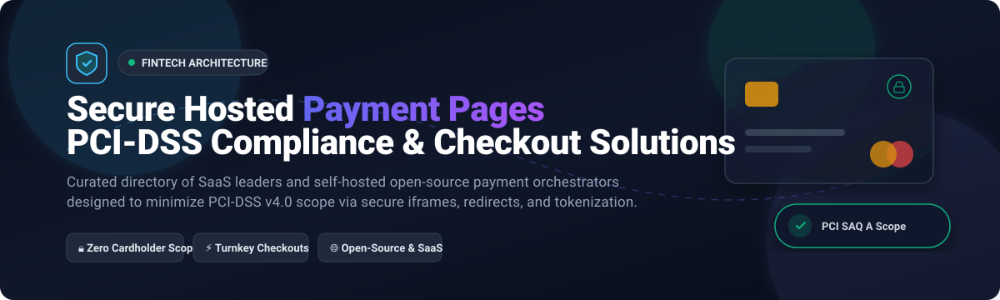

  

# 💳 Awesome Secure Hosted Payment Pages (PCI-DSS)

  
  
  
  
  
  
  

> 🛒 A curated list of top **Secure Hosted Payment Page platforms** and **hosted checkout solutions** — covering commercial SaaS market leaders and self-hosted open-source software for accepting online payments while minimizing PCI-DSS compliance scope (SAQ A / SAQ A-EP).

🌟 **Star this repository if you find it helpful!** 🌟

---

## 📋 Table of Contents

- [🌐 Sector Overview & Market Dynamics](#-sector-overview--market-dynamics)
- [🟦 SaaS / Hosted Platforms](#-saas--hosted-platforms)
  - [📊 Commercial SaaS Comparison Matrix](#-commercial-saas-comparison-matrix)
  - [🔍 SaaS Platform Deep Dives](#-saas-platform-deep-dives)
- [🟩 Open-Source Software](#-open-source-software)
  - [⭐ Open-Source Solutions by Stars_Count](#-open-source-solutions-by-star-count)
  - [🔬 Open-Source Project Deep Dives](#-open-source-project-deep-dives)
- [⚖️ Comparison at a Glance](#-comparison-at-a-glance)
- [📈 Star History](#-star-history)
- [💖 Support & Sponsorship](#-support--sponsorship)
- [🤝 Contributing](#-contributing)
- [📄 License](#-license)

---

## 🌐 Sector Overview & Market Dynamics

The global payment gateway and hosted checkout market is estimated at **$48B–$58B+ in 2025–2026** (expanding at ~15%–18% CAGR), with hosted payment pages capturing over **55%–58% of traditional e-commerce transaction volume** due to strict PCI-DSS v4.0 compliance mandates.

Market dynamics reflect a **moderately concentrated, winner-take-most tier at the infrastructure layer** dominated by global payment juggernauts (PayPal, Stripe, Adyen, and Visa/Authorize.Net), while remaining **fragmented and competitive across regional gateways, specialized Merchant of Record (MoR) providers, and emerging self-hosted payment orchestrators**.

---

## 🟦 SaaS / Hosted Platforms

Commercial, cloud-hosted Secure Hosted Payment Page platforms sorted in descending order by enterprise valuation and scale.

### 📊 Commercial SaaS Comparison Matrix

| Platform | Company Valuation / Revenue | Pricing (Starting Tier) | Free Tier / Trial Limits | Key Capabilities |
| :--- | :--- | :--- | :--- | :--- |
| **[Authorize.Net](https://www.authorize.net/)** | 🏢 **$500B+ Market Cap** *(Visa parent; $2.0B acq.)* | 💰 **$25 / month + $0.10 / txn** *(Gateway only)* or **$25 / month + 2.9% + $0.30 / txn** *(All-in-One)* | 🔒 **No free tier**; Free developer sandbox with unlimited test transactions | Server Integration Method (SIM) & Hosted Payment Form, fraud suite, virtual terminal, recurring billing. |
| **[PayPal](https://www.paypal.com/)** | 🏢 **$80B – $85B Market Cap** *(~$30B Annual Revenue)* | 💰 **2.99% + $0.49 per transaction** *(Standard Hosted Checkout; no monthly fee)* | 🎁 **Free account forever**; No setup fees, pay only per successful transaction; full developer sandbox | Hosted Checkout, Venmo, Pay Later, digital wallets, global coverage across 200+ markets & 130+ currencies. |
| **[Stripe](https://stripe.com/)** | 🏢 **$65B – $70B Valuation** *(~$16B+ Net Revenue)* | 💰 **2.9% + $0.30 per successful card charge** *(Pay-as-you-go; no monthly fee)* | 🎁 **Free account forever**; No setup/monthly fees, unlimited test transactions in developer mode | Stripe Checkout Sessions, pre-built payment links, localized payment methods (100+), Smart Retries. |
| **[Adyen](https://www.adyen.com/)** | 🏢 **$40B – $45B Market Cap** *(~$2.0B Net Revenue)* | 💰 **$0.13 fixed processing fee + Interchange++** *(per transaction; no monthly fee)* | 🔒 **No free tier**; Free test platform sandbox; minimum monthly invoice threshold applies in production | Enterprise Hosted Checkout, custom themes, omnichannel acquiring, global multi-currency tokenization. |
| **[Square](https://squareup.com/)** | 🏢 **$40B – $45B Market Cap** *(Block Inc.; ~$22B Gross Rev)* | 💰 **3.3% + $0.30 per transaction** *(Square Free Plan; $0/month)* or **2.9% + $0.30** *(Square Plus at $49/mo)* | 🎁 **Free plan forever** with $0 monthly fee (pay per txn); 30-day free trial on Plus/Premium tiers | Square Hosted Checkout & Payment Links, auto payment reminders, inventory and Customer Directory sync. |
| **[Checkout.com](https://www.checkout.com/)** | 🏢 **$12B Valuation** *(~$750M Net Revenue)* | 💰 **Custom Interchange++ or blended rate** *(approx. 0.95%–1.99% + $0.10–$0.20 per txn; no monthly fee)* | 🔒 **No free live tier**; Free developer sandbox environment for test cards & simulated flows | Hosted Payments Pages, Payment Links via SMS/email, granular 3D Secure 2, real-time fraud monitoring. |
| **[Mollie](https://www.mollie.com/)** | 🏢 **$6.5B Valuation** *(~$214M Revenue)* | 💰 **1.80% + €0.25 per transaction** *(EEA cards; no monthly fee)* | 🎁 **Free account forever**; No monthly/setup fees, test mode sandbox with unlimited mock payments | Branded hosted payment links, QR code checkouts, European payment methods (iDEAL, Bancontact, SEPA). |
| **[Chargebee](https://www.chargebee.com/)** | 🏢 **$3.5B Valuation** *(~$200M ARR)* | 💰 **$0/month base** *(Starter plan; 0.75% overage after threshold)* or **$599/month** *(Performance tier)* | 🎁 **Free for first $250,000** cumulative lifetime billing on Starter plan; or 14-day free trial | PCI DSS Level 1 hosted checkout pages, customer self-serve portal, dunning & revenue recovery automation. |
| **[FastSpring](https://fastspring.com/)** | 🏢 **$500M – $800M Est. Valuation** *(~$1B+ TPV)* | 💰 **5.9% + per transaction** or custom revenue-share *(Merchant of Record; no monthly fee)* | 🔒 **No free tier**; Free developer sandbox store for end-to-end checkout & webhook testing | Full Merchant of Record (MoR), hosted storefront, global sales tax/VAT remittance, automated invoicing. |

---

### 🔍 SaaS Platform Deep Dives

#### 💳 Chargebee Hosted Pages
- **Type:** Full-featured billing hosted pages with PCI DSS Level 1
- **Overview:** Chargebee's hosted capabilities provide pre-built, configurable pages for checkout, customer portal, payment method management, and pay-now invoice collection. For card payments, they help meet most PCI DSS compliance requirements with Level 1 compliance. Pages can be embedded via `Chargebee.js` (which creates and manages the secure iframe) rather than placing raw URLs in manual iframes. Supported features include multiple payment gateways, localization, brand customization, automated tax calculation, and subscription management offloading.
- **Best for:** Subscription and SaaS businesses already using Chargebee for billing wanting hosted checkout and portal pages that offload PCI scope alongside subscription management.

#### 💳 Stripe Hosted Checkout
- **Type:** Hosted payment pages with intelligent recovery and compliance tooling
- **Overview:** Stripe Checkout Sessions provide turnkey hosted payment pages for one-time payments and recurring subscriptions. Stripe automatically adapts to customer device, language, and currency, supporting over 100 payment methods. Revenue recovery features include Smart Retries (recovering 57% of failed recurring payments on average), automated reminder emails, and a hosted customer portal for updating payment details.
- **Best for:** Development teams wanting a battle-tested, globally localized hosted checkout experience with built-in fraud prevention (Radar) and zero server PCI scope.

#### 💳 PayPal Hosted Checkout
- **Type:** Hosted checkout with comprehensive consumer payment method coverage
- **Overview:** PayPal's hosted checkout accepts PayPal, Venmo, Pay Later, cryptocurrency, and major credit/debit cards across 200+ markets and 130+ currencies. PayPal manages all PCI compliance for the hosted flow, backed by built-in risk algorithms and Seller Protection on eligible transactions.
- **Best for:** Businesses seeking high consumer trust and conversion through broad wallet coverage (PayPal, Venmo) without monthly software subscription overhead.

#### 💳 Adyen Hosted Checkout
- **Type:** Highly customizable enterprise hosted checkout with theme architecture
- **Overview:** Adyen Hosted Checkout supports theme creation with custom brand logos, typography, and color schemes, where the theme ID is passed dynamically in the session initiation request. The session response returns a time-bound hosted payment page URL. Adyen supports hundreds of local and international payment methods with advanced risk scoring (RevenueProtect) and automated tokenization.
- **Best for:** Global omnichannel enterprises and merchants wanting brand-aligned, themeable hosted checkout pages with direct bank acquiring.

#### 💳 Square Hosted Checkout
- **Type:** Hosted payment links for forms, invoices, and e-commerce
- **Overview:** Square Hosted Checkout enables merchants to generate instant payment links and checkout URLs without maintaining a standalone web storefront. Buyers are redirected to a Square-hosted page to complete payment and then returned to the merchant site. Features include pre-populated buyer contact details, automatic payment reminders for unpaid invoices, and real-time synchronization with the Square Customer Directory.
- **Best for:** Omnichannel businesses and SMBs needing straightforward hosted checkout links for forms, social selling, and service billing.

#### 💳 FastSpring Storefront
- **Type:** Merchant of Record storefront with hosted checkout & tax remittance
- **Overview:** FastSpring acts as an authorized Merchant of Record (MoR), absorbing total liability for payment processing, chargebacks, fraud, and global sales tax / VAT / GST collection and filing. The hosted storefront handles localized checkouts, digital fulfillment, recurring billing, and self-service buyer portals.
- **Best for:** Global software, SaaS, and digital goods publishers seeking complete relief from international tax regulations and chargeback liabilities.

#### 💳 Mollie Payment Links
- **Type:** European-centric hosted payment links with QR code integration
- **Overview:** Mollie Payment Links generate secure URLs and QR codes directing customers to a branded checkout page. Links can be created through the Mollie Web App, mobile dashboard, or programmatically via the Payment Links API, with support for custom expiry dates and webhook notifications. Mollie handles all cardholder data within its secure infrastructure.
- **Best for:** European merchants and service businesses desiring frictionless, shareable payment links with rich support for regional payment methods (iDEAL, Bancontact, SEPA).

#### 💳 Checkout.com Hosted Payments
- **Type:** Enterprise hosted payment pages and shareable payment links
- **Overview:** Checkout.com provides Hosted Payments Pages where customers enter payment information on Checkout.com-hosted secure domains. Payment tokens are securely created in the background to finalize transactions, reducing merchant infrastructure to SAQ A PCI compliance. Payment Links can be dispatched across SMS, messaging apps, and email.
- **Best for:** High-volume digital platforms, marketplaces, and cross-border merchants wanting enterprise-grade payment performance and granular routing.

#### 💳 Authorize.Net SIM Hosted Form
- **Type:** Established hosted payment form with customizable template controls
- **Overview:** Authorize.Net's Server Integration Method (SIM) and modern hosted payment forms provide customizable checkout forms where card data is captured directly on Visa/Authorize.Net servers. Merchants can configure color palettes, field validations, and automated fraud filters (AFDS), shifting compliance away from self-hosted servers.
- **Best for:** Established merchants utilizing Authorize.Net gateway services who require a quick, secure checkout page without building custom tokenized payment forms.

---

## 🟩 Open-Source Software

Self-hosted, community-driven payment orchestration platforms, self-hosted checkout engines, and crypto payment processors. These solutions provide self-hosted alternatives for managing checkout flows, payment routing, and multi-gateway connectivity while keeping sensitive cardholder data isolated or delegating to compliant tokenization vaults.

### ⭐ Open-Source Solutions by Stars_Count

| Project | GitHub_Stars | Language / Stack | License | Primary Focus |
| :--- | :---: | :--- | :--- | :--- |
| **[juspay/hyperswitch](https://github.com/juspay/hyperswitch)** |  | Rust | Apache-2.0 | High-performance open-source payment switch & PCI-compliant hosted checkout |
| **[medusajs/medusa](https://github.com/medusajs/medusa)** |  | TypeScript / Node.js | Medusa License | Headless commerce engine with modular hosted & embedded checkout flows |
| **[getlago/lago](https://github.com/getlago/lago)** |  | Ruby / Go / TypeScript | AGPL-3.0 | Open-source metering, subscription billing, and customer payment portal |
| **[btcpayserver/btcpayserver](https://github.com/btcpayserver/btcpayserver)** |  | C# / ASP.NET Core | MIT | Self-hosted, non-custodial Bitcoin & Lightning Network hosted checkout server |
| **[killbill/killbill](https://github.com/killbill/killbill)** |  | Java | Apache-2.0 | Enterprise open-source subscription billing & payment gateway routing platform |
| **[bitcart/bitcart](https://github.com/bitcart/bitcart)** |  | Python / Vue.js | MIT | Self-hosted multi-cryptocurrency checkout page & payment processor |
| **[commercelayer/mfe-checkout](https://github.com/commercelayer/mfe-checkout)** |  | TypeScript / React | MIT | Open-source micro-frontend checkout application with PCI-compliant payment integrations |
| **[muhammad-fiaz/payfolio](https://github.com/muhammad-fiaz/payfolio)** |  | Next.js / TypeScript | MIT | Self-hosted creator donation page delegating card handling to Razorpay checkout |

---

### 🔬 Open-Source Project Deep Dives

#### ⚡ [juspay/hyperswitch](https://github.com/juspay/hyperswitch)
- **Repository:** [juspay/hyperswitch](https://github.com/juspay/hyperswitch) 
- **Stack:** Rust / WebAssembly / PostgreSQL | **License:** Apache-2.0
- **Overview:** A high-performance, open-source payment orchestration platform built in Rust. Hyperswitch acts as a universal switch connecting to 50+ payment processors, payout providers, and card vaults. It provides out-of-the-box pre-built, PCI-compliant hosted payment pages, embedded SDKs, intelligent transaction routing, zero-code checkout switching, and revenue recovery features.
- **Best for:** Fast-growing businesses and enterprises wanting to eliminate payment gateway vendor lock-in with a self-hostable, PCI-compliant checkout router.

#### 🐙 [medusajs/medusa](https://github.com/medusajs/medusa)
- **Repository:** [medusajs/medusa](https://github.com/medusajs/medusa) 
- **Stack:** TypeScript / Node.js / PostgreSQL | **License:** Medusa License
- **Overview:** Leading modular open-source digital commerce backend. Medusa isolates checkout sessions, tax calculations, and payment provider flows into pluggable modules. It interfaces seamlessly with hosted payment redirect workflows (Stripe, Adyen, PayPal, Klarna) so merchant servers never process or store raw Primary Account Numbers (PANs).
- **Best for:** Developers building tailored modern e-commerce storefronts requiring fully customizable checkout flows with isolated PCI boundaries.

#### 🦩 [getlago/lago](https://github.com/getlago/lago)
- **Repository:** [getlago/lago](https://github.com/getlago/lago) 
- **Stack:** Ruby on Rails / Go / TypeScript | **License:** AGPL-3.0
- **Overview:** Open-source metering, billing, and subscription management architecture. Lago offers an open-source alternative to Chargebee and Stripe Billing, featuring a hosted customer payment portal for updating credit cards, reviewing past invoices, and executing one-click payments through integrated PSP token vaults.
- **Best for:** SaaS, API, and cloud infrastructure companies looking for self-hosted subscription billing with customer payment portals.

#### ₿ [btcpayserver/btcpayserver](https://github.com/btcpayserver/btcpayserver)
- **Repository:** [btcpayserver/btcpayserver](https://github.com/btcpayserver/btcpayserver) 
- **Stack:** C# / ASP.NET Core / Docker | **License:** MIT
- **Overview:** Free, open-source, and non-custodial cryptocurrency payment processor. It generates secure hosted checkout invoices with dynamic QR codes, Lightning Network invoice generation, and refund management with 0% transaction fees and zero intermediary custody.
- **Best for:** Merchants and organizations looking to host their own cryptocurrency payment checkout without third-party fees, transaction surveillance, or chargeback risk.

#### 💰 [killbill/killbill](https://github.com/killbill/killbill)
- **Repository:** [killbill/killbill](https://github.com/killbill/killbill) 
- **Stack:** Java / OSGi / MySQL / MariaDB | **License:** Apache-2.0
- **Overview:** Enterprise-grade open-source subscription billing and payments engine. Kill Bill connects to multiple payment gateways, manages recurring billing cycles, dunning retries, and invoices, while providing plugin architectures for hosted payment form redirection.
- **Best for:** Large enterprise organizations requiring complete on-premise control over recurring billing records and multi-gateway processing pipelines.

#### 🛒 [bitcart/bitcart](https://github.com/bitcart/bitcart)
- **Repository:** [bitcart/bitcart](https://github.com/bitcart/bitcart) 
- **Stack:** Python / FastAPI / Vue.js | **License:** MIT
- **Overview:** Lightweight, self-hosted cryptocurrency checkout engine and payment gateway supporting Bitcoin, Ethereum, Monero, Litecoin, and major stablecoins. Features ready-to-use hosted checkout pages, point-of-sale interfaces, and e-commerce plugin integrations.
- **Best for:** Self-hosters and merchants requiring a multi-currency crypto checkout page with minimal resource footprint.

#### 🛍️ [commercelayer/mfe-checkout](https://github.com/commercelayer/mfe-checkout)
- **Repository:** [commercelayer/mfe-checkout](https://github.com/commercelayer/mfe-checkout) 
- **Stack:** TypeScript / React / Tailwind CSS | **License:** MIT
- **Overview:** Open-source micro-frontend (MFE) checkout application designed for headless commerce. Renders a secure, high-conversion hosted checkout experience supporting customer address validation, delivery options, and secure payment tokenization across diverse gateways.
- **Best for:** Headless commerce engineering teams looking for a customizable, decoupled hosted checkout UI.

#### ☕ [muhammad-fiaz/payfolio](https://github.com/muhammad-fiaz/payfolio)
- **Repository:** [muhammad-fiaz/payfolio](https://github.com/muhammad-fiaz/payfolio) 
- **Stack:** Next.js / TypeScript / Tailwind CSS | **License:** MIT
- **Overview:** Self-hosted creator donation page serving as an open-source alternative to Buy Me a Coffee and Ko-fi. Delegates card handling and PCI scope directly to Razorpay's hosted checkout modal.
- **Best for:** Independent creators seeking a personal branded donation landing page.

---

## ⚖️ Comparison at a Glance

| Software | Model | Stack | PCI Scope Reduction | Hosted Checkout Page | Self-Hosted | Primary Strength |
| :--- | :---: | :--- | :---: | :---: | :---: | :--- |
| **Authorize.Net** | SaaS | Cloud | ✅ SAQ A / SIM | ✅ SIM / Hosted Form | ❌ | Established gateway backed by Visa network |
| **PayPal** | SaaS | Cloud | ✅ SAQ A | ✅ Hosted Checkout | ❌ | Unmatched consumer trust & wallet adoption |
| **Stripe** | SaaS | Cloud | ✅ SAQ A | ✅ Checkout Sessions | ❌ | Developer-first API, global payments & Smart Retries |
| **Adyen** | SaaS | Cloud | ✅ SAQ A | ✅ Branded Themes | ❌ | Global unified commerce & direct acquiring |
| **Square** | SaaS | Cloud | ✅ SAQ A | ✅ Payment Links | ❌ | Turnkey payment links & POS sync |
| **Checkout.com** | SaaS | Cloud | ✅ SAQ A | ✅ Hosted Pages | ❌ | Enterprise scale & granular 3D Secure routing |
| **Mollie** | SaaS | Cloud | ✅ SAQ A | ✅ Payment Links | ❌ | European payment coverage & QR code checkout |
| **Chargebee** | SaaS | Cloud | ✅ Level 1 | ✅ Checkout / Portal | ❌ | Subscription billing with PCI Level 1 pages |
| **FastSpring** | SaaS | Cloud | ✅ MoR Scope | ✅ Hosted Storefront | ❌ | Full Merchant of Record tax & liability offload |
| **Hyperswitch** | OSS | Rust | ✅ Built-in / SAQ A | ✅ Pre-built Pages | ✅ | Multi-processor orchestration & zero gateway lock-in |
| **Medusa** | OSS | TypeScript | ✅ Delegated | ✅ Modular Flows | ✅ | Composable headless commerce & checkout modules |
| **Lago** | OSS | Ruby / Go | ✅ Delegated | ✅ Billing Portal | ✅ | Self-hosted metering & customer payment portal |
| **BTCPay Server** | OSS | C# | ✅ Non-custodial | ✅ Hosted Invoices | ✅ | 0% fee self-hosted Bitcoin & Lightning checkout |
| **Kill Bill** | OSS | Java | ✅ Plugin Vault | ✅ Plugin Gateway | ✅ | Enterprise subscription billing & custom gateway routing |
| **Bitcart** | OSS | Python | ✅ Non-custodial | ✅ Hosted Invoices | ✅ | Lightweight multi-crypto checkout processor |
| **Commerce Layer MFE** | OSS | React | ✅ Delegated | ✅ Micro-Frontend | ✅ | Decoupled modern checkout interface for headless stores |
| **Payfolio** | OSS | Next.js | ✅ (Via Razorpay) | ❌ (Delegated) | ✅ | Lightweight creator donation page |

---

## 📈 Star History

---

## 💖 Support & Sponsorship

Thank you for exploring this curated directory! If this project helps you choose the right hosted payment page, checkout provider, or open-source payment orchestrator, please consider showing support:

- 🌟 **Star** the repository on GitHub
- 🍴 **Fork** and contribute new payment solutions or documentation improvements
- 📢 **Share** with your engineering, fintech, or product teams
- ☕ **Sponsor**: Support ongoing curation and maintenance via the [GitHub Sponsor Dashboard](https://github.com/sponsors/ishandutta2007)

---

## 🤝 Contributing

Contributions are warmly welcomed! If you maintain or use an open-source payment gateway, hosted checkout engine, or PCI scope reduction tool that should be included:

1. Fork this repository.
2. Add your entry under the appropriate section following star-count or valuation sorting guidelines.
3. Include the project's repository URL, tech stack, license, live Stars_Badge, and primary value proposition.
4. Submit a Pull Request with a descriptive summary of why the tool is valuable.

Please ensure that open-source submissions are actively maintained (commits or releases within the past 12 months) and carry an established open-source license.

---

## 📄 License

This repository and curated list are released under the [Creative Commons Zero v1.0 Universal (CC0 1.0)](https://creativecommons.org/publicdomain/zero/1.0/) license (Public Domain Dedication). All company names, logos, and trademarks belong to their respective owners.

---

  <b>⭐ Found this curated list valuable? Star the repository to show your support! ⭐</b>

